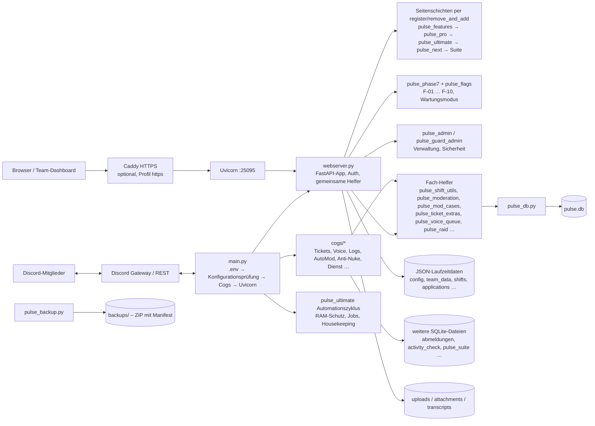

# Pulse TeamOS – Architekturübersicht

Stand: 23.10.2026 · `pulse_version.py` meldet 7.16.0 (Branch `verbesserung/phase-8-betrieb`). Beschrieben ist der vorhandene Aufbau, nicht der Zielzustand der offenen Architekturpunkte (A-01, A-02, A-04, A-05). Grundlage: DOC-02 aus `origin/verbesserung/phase-6-bot`, an diesen Stand angepasst.

## Laufzeit und Modulfluss

Bot und Dashboard laufen in **einem** Python-Prozess: `main.py` startet discord.py und danach Uvicorn mit der FastAPI-App aus `webserver.py`.

## Start in `main.py`

1. `pulse_logging.setup()` – `logs/pulse.log` (1 MB × 3) und Ringpuffer der letzten 200 Fehler.
2. `.env` laden, danach **Konfigurationsprüfung** (`pulse_env_validation`, O-06) – vor dem Import von `webserver`, damit ein ungültiger Wert, der dort den Import abbrechen würde, benannt wird. Es werden nur Namen und erwartete Bereiche ausgegeben, nie Werte.
3. `webserver` importieren (A-04: ohne Dateiseiteneffekte; `init_runtime()` im FastAPI-`lifespan`).
4. Cogs laden (`cogs/*.py`; Ladefehler landen in `bot.pulse_failed_cogs` und im Systemstatus), Slash-Befehle nur bei geändertem Befehlsbaum synchronisieren (`pulse_command_sync`).
5. Uvicorn mit `proxy_headers` und `forwarded_allow_ips` (nur Caddy darf X-Forwarded-For setzen, O-02).

## Verantwortlichkeiten

| Bereich | Einstiegspunkte | Dauerhafte Daten |
|---|---|---|
| Bot-Lifecycle, Befehlsbaum, Fehlerantworten | `main.py`, `pulse_command_errors.py`, `pulse_command_sync.py`, `pulse_interactions.py` | geladene Cogs, Sync-Prüfsumme in `pulse.db` |
| Dashboard, Login, Rechte | `webserver.py` (`auth`, `compute_perms`), `pulse_permissions.py`, `pulse_sessions.py`, `pulse_security.py` | Sitzungen und API-Schlüssel in `pulse.db`, `config.json` |
| Teamakte, Warnungen, Beförderungen | `webserver.py` (`issue_team_warning`, `finish_promotion` …), `pulse_pro.py` (`/member/{id}`), `pulse_timeline.py` | `team_data.json` |
| Schichten / Dienst | `webserver.py` (`apply_shift_action`, `process_overdue_shifts`), `cogs/dienst.py`, `pulse_shift_utils.py` | `shifts.json` |
| Tickets | `cogs/tickets.py`, `pulse_ticket_center.py`, `pulse_ticket_extras.py`, `pulse_transcripts.py` | `pulse.db`, `transcripts/`, `attachments/` |
| Voice-Support | `cogs/voice_support.py`, `pulse_voice_queue.py`, `pulse_audio_check.py` | Voice-Fälle in `pulse.db`, Audio unter `uploads/` |
| Moderation und Schutz | `cogs/automod.py`, `cogs/antinuke.py`, `cogs/mod_cases.py`, `cogs/raid_watch.py`, `pulse_moderation.py`, `pulse_guard_admin.py` | Fälle und Einstellungen in `pulse.db` |
| Bewerbungen | `career_applications.py`, `webserver.py` (`/apply`), `pulse_board.py` (F-07) | `applications.json` |
| Neue Funktionen (Phase 7) | `pulse_phase7.py`, `pulse_flags.py`, `pulse_access.py`, `pulse_insights.py`, `pulse_settings_history.py`, `pulse_public_status.py` | Schalter in `pulse.db` (`phase7_features`, `maintenance_mode`) |
| Logs, Diagnose, Systemstatus | `cogs/advanced_logs.py`, `pulse_logging.py`, `pulse_jobs.py`, `pulse_system_checks.py`, `pulse_consistency.py`, `/healthz` | `logs/`, Job-Status in `pulse.db`, `audit_logs.json` |
| Sicherungen | `pulse_backup.py`, `webserver.py` (`/backups`, `/backup/full/*`), `deploy/remote_deploy.sh` | `backups/` |
| Betrieb | `Dockerfile`, `compose.yaml`, `deploy/Caddyfile`, `deploy/vps_bootstrap.sh`, `.github/workflows/*` | – |

## Wichtige Regeln im Code

- **Seitenschichten:** Welche Implementierung einer URL aktiv ist, hängt von Registrierungsreihenfolge und `remove_and_add` ab (entfernt *alle* Methoden eines Pfads). Vor Routenänderungen `docs/ROUTEN.md` und `docs/routen_snapshot.json` beachten; `tests/test_route_snapshot.py` erkennt Abweichungen (neu erzeugen mit `python tools/route_map.py`).
- **Schichtgutschrift (E-2):** Alle Statistiken lesen Schichtdauern über `pulse_shift_utils.credited_shift_seconds`. Nach 24 h automatisch beendete Schichten zählen 0 h, bis eine höherrangige Führungskraft die Dauer in der Teamakte bestätigt (`POST /shift/history/confirm-duration`, auditiert, Obergrenze `MAX_SHIFT_HOURS`).
- **Rechte:** Deny by default; jede schreibende Route prüft serverseitig (`auth(...)`, `require_perm`). Der Wartungsmodus (F-04) sperrt Schreibzugriffe von Nicht-Admins zentral in `auth`.
- **Parallele Schreibvorgänge (K-04):** `pulse_store.merge_entry` schreibt nach `await`s nur die eigenen Änderungen zurück; Laden → Ändern → Speichern ohne `await` dazwischen ist im Event-Loop atomar.
- **Beschädigte JSON-Dateien (K-05):** werden als `*.corrupt-*` gesichert und nie still mit Standardwerten überschrieben.

## Datenablagen und Grenzen

- `pulse.db` ist die zentrale SQLite-Datenbank; ältere Cogs haben eigene SQLite-Dateien (`abmeldungen.db`, `activity_check.db`, `pulse_suite.db`, `teamliste.db`, `buero_system.db`, `rp_verwaltung.db`, `flaggenquiz.db`). Zusammenführung offen (A-05). Vollständige Liste: `docs/DATENLANDKARTE.md`.
- Laufzeit: Python 3.15 im Produktionsimage (`Dockerfile`), lokal/CI zusätzlich 3.14.
- Alle Laufzeitdaten (SQLite, JSON, Uploads, Transkripte, Backups, Logs, Wartemusik) liegen unter `PULSE_DATA_DIR` (`pulse_paths.py`, Phase 13/D-06); ohne Variable im Arbeitsverzeichnis wie bisher. Im Container ist der Code schreibgeschützt (`/app`), Daten liegen in `/data` (Host: `/opt/pulse/data`).
- `uploads/`, `attachments/`, `transcripts/`, `backups/` sind Daten, keine Build-Artefakte; `.env` und `.session_secret` sind Geheimnisse. Beides ist per `.gitignore` und `.dockerignore` ausgeschlossen.
- RAM: Containerlimit 768 MiB (+256 MiB Swap), gemeinsame Schutzschwellen im Automationszyklus 500/620/700 MB mit Hysterese (E-5). Keine zusätzlichen Dauerschleifen, Caches immer begrenzen.

## Offene Architekturarbeiten

A-01/A-02 (Seitenschichten auflösen, `webserver.py` mit rund 11.500 Zeilen zerlegen), A-04 (`pulse_ultimate`/`pulse_next` legen beim Import noch Dateien an), A-05 (Persistenz zusammenführen), A-06 (Jinja2 für neue Seiten), D-06/D-07/D-09 – Details in `docs/VERBESSERUNGSPLAN.md`.
