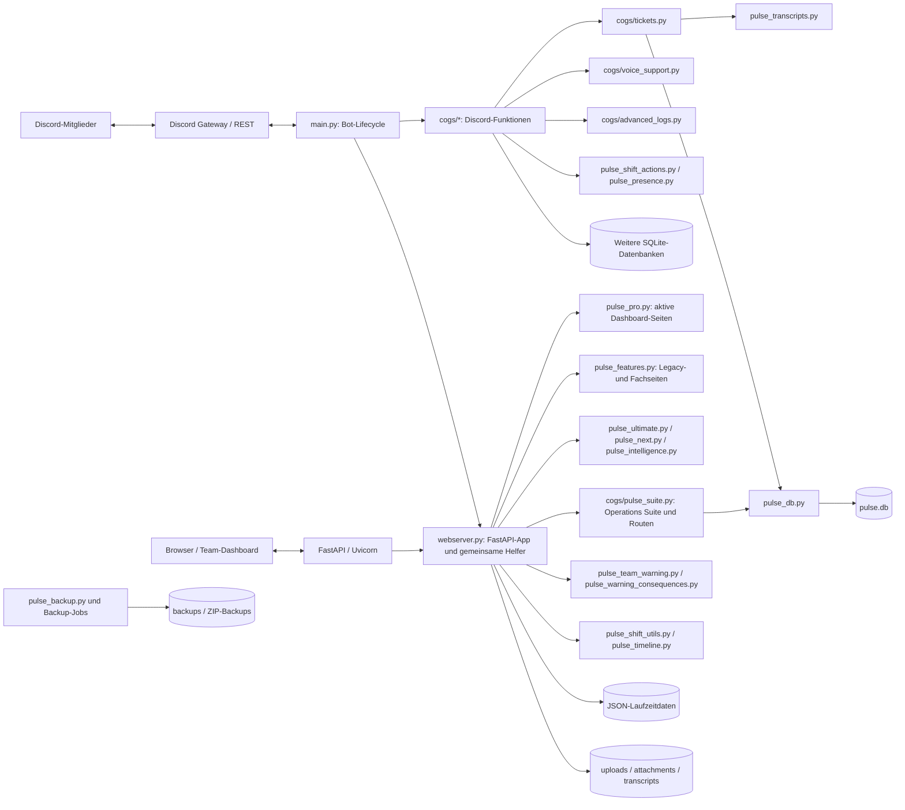

# Pulse TeamOS – Architekturübersicht

Stand: 21.10.2026 · main meldet 7.14.0. Diese Abbildung beschreibt den vorhandenen Aufbau, nicht den gewünschten Endzustand der noch offenen Architekturarbeiten.

## Laufzeit und Modulfluss

## Verantwortlichkeiten

| Bereich | Einstiegspunkte | Dauerhafte Daten |
|---|---|---|
| Bot-Lifecycle und Command-Tree | main.py | Discord-Gateway-Zustand und geladene Cogs |
| Web-Dashboard und Auth | webserver.py, pulse_pro.py | config.json, Team-/Schicht-JSON und Sessions |
| Ticket-System | cogs/tickets.py, pulse_ticket_center.py, pulse_ticket_locks.py | Tickets in pulse.db, Transkripte und Anhänge |
| Voice-Support | cogs/voice_support.py | Voice-Fälle in Pulse-DB/Settings, optionale Audio-Dateien |
| Teamwarnungen und Schichten | pulse_team_warning.py, pulse_warning_consequences.py, pulse_shift_utils.py | Warnungen in Teamdaten-JSON, Schichten in shifts.json |
| Logs und Diagnose | cogs/advanced_logs.py, pulse_logging.py, pulse_jobs.py | begrenzte Logs, Job- und Audit-Daten |
| Sicherungen | pulse_backup.py, webserver.py | backups/ mit Manifest und Restore-Test |

## Datenablagen und Grenzen

- pulse.db ist die gemeinsame SQLite-Datenbank für zentrale Bereiche; einzelne ältere Cogs besitzen weiter eigene SQLite-Dateien. Die Vereinheitlichung auf eine Datei ist noch offen (A-05).
- Konfigurations- und historische Laufzeitdaten liegen weiterhin in JSON-Dateien im Arbeitsverzeichnis. PULSE_DATA_DIR ist nicht als einheitliche Ablage über alle Module umgesetzt (D-06).
- uploads/, attachments/, transcripts/ und backups/ sind persistente Daten und keine bloßen Build-Artefakte.
- .env und .session_secret sind sicherheitskritische Laufzeitdateien: weder in Container-Images noch in Git commits einbetten.
- Die aktive FastAPI-Routenliste hängt von Registrierungsreihenfolge und remove_and_add ab. Vor Routenänderungen docs/ROUTEN.md und docs/routen_snapshot.json beachten.

## Offene Architekturarbeiten

A-01/A-02/A-04/A-05 bleiben offen: webserver.py ist weiterhin groß, mehrere Routenschichten überlagern einander, nicht alle Imports sind nebenwirkungsfrei und persistente Daten sind noch nicht vollständig aus dem Codeverzeichnis getrennt.
